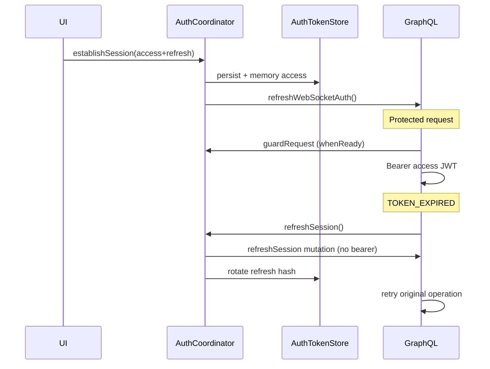

# Authentication flow — Garaj Market

## Token model

| Token | TTL | Storage (mobile) | Storage (server) |
|-------|-----|------------------|------------------|
| Access JWT | 15 minutes | Secure storage + memory | N/A (stateless verify) |
| Refresh token | 30 days | Secure storage only | **SHA-256 hash** in `sessions` |
| Session id | — | Secure storage | MongoDB `sessions._id` |
| Token version | — | In session JSON | `users.tokenVersion` — bump revokes all |

**Never** store raw refresh tokens in MongoDB.

## Mobile lifecycle

## Bootstrap (cold start)

1. `main()` → `AuthProvider.loadAuth()` → `AuthCoordinator.bootstrap()`  
2. Restore session from SharedPreferences + sync secure storage  
3. Set memory access token **before** any GraphQL  
4. Optional silent refresh if refresh token present  
5. `pushService.onSignedIn` only after tokens ready  

## Sign-in / OTP

1. `clearOrphanBearerIfGuest()`  
2. Public operation (`SignIn` / `ConfirmSignUp`) — no Bearer  
3. `establishSession()` — **await** before navigation / pending replay  
4. `PendingActionManager.replay()`  

## Logout

- **This device:** `logoutSession` + clear local storage + disconnect WS  
- **All devices:** `logoutAllDevices` + bump `tokenVersion` server-side  

## Error codes

| Code | Client behavior |
|------|-----------------|
| `TOKEN_EXPIRED` | Refresh + retry once |
| `INVALID_REFRESH_TOKEN` | Clear session → sign-in |
| `SESSION_REVOKED` | Clear session → sign-in |
| `UNAUTHENTICATED` | Do not auto-logout (generic) |

## Backward compatibility

If API still returns only `token`:

- Treated as `accessToken`  
- No refresh → on expiry user must sign in again  
- When backend ships `refreshToken`, client enables rotation automatically  

## Web (optional)

- Refresh token in **httpOnly, Secure, SameSite=strict** cookie  
- Access token in memory or short-lived cookie  
- CSRF double-submit for cookie mode  

See `docs/backend/nestjs-auth-reference/README.md`.
