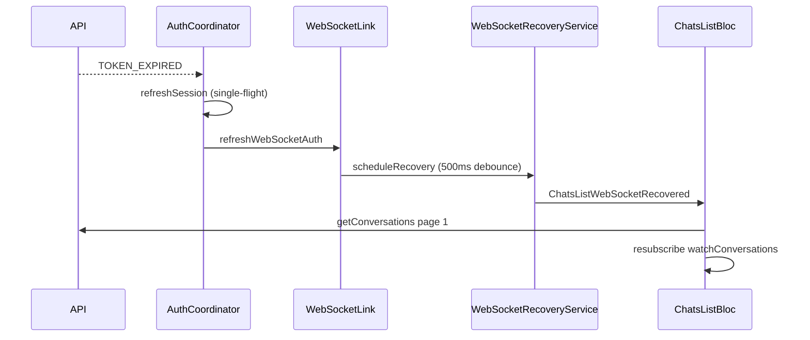

# WebSocket recovery architecture

## Problem

After `TOKEN_EXPIRED` → refresh → `wsLink.dispose()` → reconnect:

- GraphQL subscriptions are recreated client-side
- Events during disconnect window are **lost**
- Duplicate events possible if both subscription + HTTP sync fire

## Client strategy (implemented)



### Components

| File | Role |
|------|------|
| `websocket_recovery_service.dart` | Debounced broadcast |
| `chat_realtime_recovery.dart` | Dispatches bloc events |
| `chats_list_bloc` | Full inbox resync + resubscribe |
| `chat_room_bloc` | `ChatRoomResubscribe` + page-1 merge (dedupe by id) |

### Dedup

`ChatRoomPrefetchLatest` merges messages by `id` in a map — replays do not duplicate bubbles.

## Backend recommendation

Add optional cursor on subscriptions:

```graphql
subscription MessageReceived($conversationId: ObjectId!, $after: DateTime) {
  messageReceived(conversationId: $conversationId, after: $after) { ... }
}
```

Or `lastEventId` per conversation in Mongo for gap fill API:

```graphql
query SyncMessages($conversationId: ObjectId!, $since: DateTime!) {
  syncMessages(conversationId: $conversationId, since: $since) { ... }
}
```

## Reconnect debounce

500ms collapses burst signals from:

- `refreshWebSocketAuth`
- `autoReconnect` timer
- manual network flap
